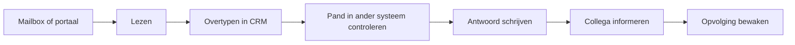
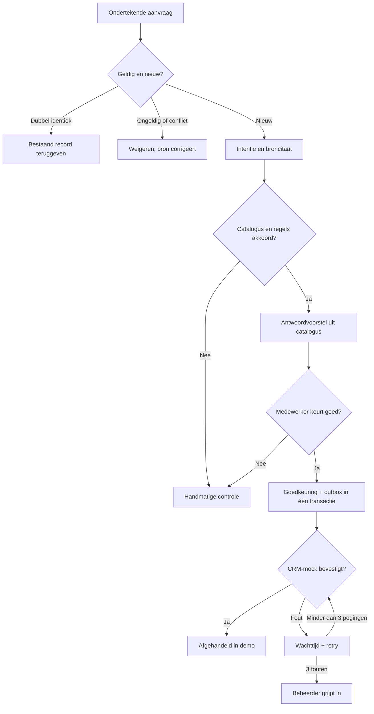

# Case: van aanvraag naar betrouwbare opvolging

Duin & Dorp is een fictief vastgoedkantoor in de kustregio. Dit is een ontwerpaanname, geen verslag van echte medewerkers of systemen. Voor zaakvoerder en teamverantwoordelijke.

## Waarom deze use case?

| Optie                               | Waarde                                   | Risico / afhankelijkheid                    | Besluit               |
| ----------------------------------- | ---------------------------------------- | ------------------------------------------- | --------------------- |
| Inkomende aanvragen controleren     | Minder overdracht, consistente opvolging | CRM-toegang en actuele pandbron             | Eerste pilot          |
| Juridische documenten interpreteren | Minder leestijd mogelijk                 | Grote gevolgen bij fouten; specialist nodig | Later apart ontwerpen |
| Automatisch publiceren / mailen     | Sneller uitvoeren                        | Onjuiste beloften, externe gevolgen         | Buiten scope          |
| Personen rangschikken op kenmerken  | Onduidelijke proceswaarde                | Ongerechtvaardigde uitsluiting              | Niet bouwen           |

## AS-IS: te toetsen werkhypothese

Risico's: meerdere bronnen, dubbele invoer, oude pandinformatie, onduidelijk eigenaarschap en geen zichtbaar verschil tussen klaarzetten en werkelijk afhandelen.

## TO-BE

De medewerker beslist over het antwoord en de verdere opvolging. “Afgehandeld” betekent in deze case alleen ontvangst door de CRM-mock. De persoonlijke reactie aan de klant is een volgende stap buiten het prototype.

## Businesscase als scenario

Startwaarden calculator: 250 aanvragen/maand, 8 actieve minuten vóór, 4 ná, €35/uur capaciteitswaarde, €120/maand beheer en tools, €3.500 implementatie. Alle waarden zijn fictieve aannames.

`uren = aanvragen × (minuten vóór − minuten ná) / 60`

`netto capaciteitswaarde = uren × uurwaarde − maandkosten`

`terugverdientijd = investering / positieve netto waarde`

Capaciteit is geen cashbesparing. Tel uitzonderingen, controlewerk, licenties en beheer mee. Meet in de pilot ook persoonlijke responstijd (mediaan/P90 tijdens kantooruren), correcties en dubbele records. Geen conversie- of besparingsclaim zonder nulmeting.

## Discovery vóór een echte bouw

Vraag naar kanalen en volumes, eigenaar per kantoor en back-up bij afwezigheid, gezaghebbende pandbron, contractueel beschikbare CRM-API, webhookgaranties, CRM-contactmatching, marketingtoestemming, foutafhandeling en meetmethode. De websitebouwer of footer bewijst niet welk intern CRM of API-contract beschikbaar is.

Volgende: [architectuur](docs/architecture.md), [keuzes](docs/decisions.md), [pilot](docs/operations.md).
