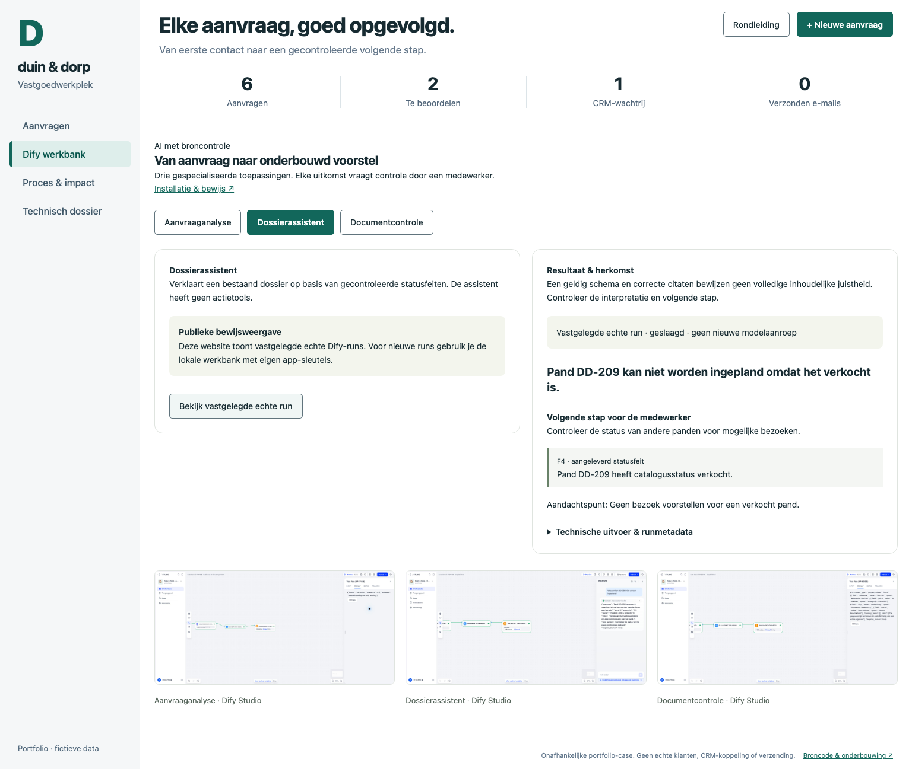

# Duin & Dorp · vastgoedautomatisering

Een vastgoedaanvraag één keer ontvangen, controleren en betrouwbaar aan een collega overdragen. Deze case verbindt procesanalyse met een werkende app en een geteste lokale API.

**[Demo + rondleiding](https://phlppgdfry.github.io/real-estate-automation-workbench/?tour)** · **[Dify werkbank](https://phlppgdfry.github.io/real-estate-automation-workbench/?view=dify)** · **[Dify-installatie](docs/dify-integration.md)** · **[Start hier](START-HERE.md)** · **[Bewijsmatrix](EVIDENCE.md)** · **[Architectuur](docs/architecture.md)** · **[Kennisgids](docs/knowledge.md)**

> Onafhankelijke portfolio-case voor een fictief vastgoedkantoor. Alle namen, aanvragen en panden zijn verzonnen. Geen relatie met een echte werkgever, vertrouwelijke informatie, geclaimde productie-ervaring of gerealiseerde besparing. Uitgewerkt met AI-assistentie; beoordeel de bron en laat de auteur keuzes uitleggen en aanpassen.




## Het probleem

Website, mailbox en portaal leveren aanvragen aan. Medewerkers moeten het doel herkennen, het juiste pand opzoeken, prijs en beschikbaarheid controleren, een antwoord voorbereiden en opvolging registreren. Bij elke overdracht kan informatie verloren gaan.

```text
Aanvraag → ondertekende ontvangst → validatie & duplicaatcontrole → duurzame inbox
        → analyseworker → intentie + broncitaat → cataloguscontrole → antwoordvoorstel
        → menselijke goedkeuring → transactionele outbox
        → CRM-mock → ontvangstbevestiging
```

De browserdemo en server delen dezelfde domeinregels. De server gebruikt SQLite voor duurzame ontvangst vóór AI-analyse, plus een worker met leases. De optionele AI-adapter extraheert uitsluitend intentie, pandreferentie en een letterlijk citaat. Antwoorden worden samengesteld uit gecontroleerde catalogusdata. Er is geen e-mailtransport en geen AI met CRM-tools.

## Probeer in twee minuten

1. Keur Lottes voorstel goed. De CRM-wachtrij groeit.
2. Schakel **CRM-fout simuleren** in en verwerk de wachtrij. Bekijk het gebeurtenissenlog. Schakel de fout uit en probeer na de wachttijd opnieuw.
3. Open Noor: het pand is verkocht. Goedkeuring is geblokkeerd.
4. Maak een aanvraag met een verdachte instructie of ontbrekende referentie.
5. Open **Dify werkbank**, kies een toepassing en bekijk een vastgelegde echte run met broncitaten.
6. Open **Proces & impact** en verander de aannames van de businesscase.

## Belangrijkste keuzes

- **AI als begrensde extractor:** schema én bronvalidatie; prijzen komen uit een catalogus; medewerker beslist. [Afwegingen](docs/decisions.md)
- **Kleine monoliet:** gedeelde TypeScript-kern, SQLite en echte rollback-/restarttests. Geen cloud nodig om het proces te beoordelen. [Architectuur](docs/architecture.md)
- **Outbox en ontvangstbewijs:** goedkeuring en opdracht ontstaan atomair. De mock gebruikt een unieke externe sleutel; dat bewijst geen exactly-once netwerkaflevering. [Runbook](docs/operations.md)

## Zelf starten en controleren

Vereist: Node.js 24+, npm en Python 3.

```bash
git clone https://github.com/phlppgdfry/real-estate-automation-workbench.git
cd real-estate-automation-workbench
npm ci
npm run dev
# http://127.0.0.1:5187/real-estate-automation-workbench/?tour
```

```bash
npm run check       # evaluatie, build, tests, storingsdrill, contract en links
npx playwright install chromium
npm run test:e2e    # workflow, rondleiding, mobiel
```

Lokale API, in een tweede terminal:

```bash
npm run setup:local # lokale secrets en fictieve catalogus; toont geen secrets
npm run server     # uitsluitend http://127.0.0.1:4318
# In een derde terminal:
npm run demo:api    # signed webhook → goedkeuring → CRM-mock; herhaalbaar
```

De standaard-API gebruikt herkenningsregels. De [Dify-integratie](docs/dify-integration.md) bevat drie importeerbare en werkelijk geteste Cloud-apps: aanvraaganalyse, dossieradvies en documentcontrole. De lokale server bedient ook de gebouwde werkbank en biedt geauthenticeerde Dify-routes. De publieke website toont expliciet vastgelegde echte runs. App-sleutels blijven in de genegeerde serveromgeving; een lokale reviewer gebruikt een aparte sessietoken. De [OpenAI-adapter](server/ai.ts) heeft contracttests; daarvoor wordt geen live verificatie geclaimd. De oorspronkelijke demo blijft zonder providerbudget bruikbaar.

Verwacht: zes fictieve aanvragen. Goedkeuring zet een aanvraag in de wachtrij, succesvolle simulatie verandert die in afgehandeld. De e-mailteller blijft nul. `demo:api` bewijst de persistente serverketen afzonderlijk. De Pages-browser communiceert niet met de lokale API: de publieke demo is zonder accounts of infrastructuur te beoordelen.

## Bewijs en grenzen

| Onderdeel                                          | Status                                                                                   |
| -------------------------------------------------- | ---------------------------------------------------------------------------------------- |
| App, formulieren, filtering, goedkeuring, retry    | Werkend met browseropslag                                                                |
| HMAC-webhook, versiecontrole, domeinregels         | Werkend, getest                                                                          |
| SQLite-outbox en unieke CRM-ontvangst              | Lokaal werkend; herstart en rollback getest                                              |
| CRM, panden, klanten, tijdwinst                    | Mock / fictief / scenario                                                                |
| Dify-analyse, dossieradvies, tekstcontrole         | Drie Cloud-apps, echte API-runs en lokale ketentest; [bewijs](public/dify/evidence.json) |
| OpenAI-extractie                                   | Adapter en contracttests; live test open                                                 |
| Productie-SSO, echt CRM, agenda, mail, alertdienst | Niet geïmplementeerd                                                                     |

De ontwikkelset scoort 24/24; de aanvullende diagnostische set 13/16. Drie taalvarianten gaan naar een medewerker. Beide sets zijn AI-geschreven en tijdens ontwikkeling/review gebruikt: geen onafhankelijke benchmark of live LLM-score. [Methode en missers](docs/evaluation.md).

## Wegwijzer

| Vraag                                     | Artefact                                                           |
| ----------------------------------------- | ------------------------------------------------------------------ |
| Welk bedrijfsproces verbetert dit?        | [Case](CASE_STUDY.md)                                              |
| Welke kennis wordt zichtbaar?             | [EVIDENCE](EVIDENCE.md), [kennisgids](docs/knowledge.md)           |
| Hoe werkt de integratie?                  | [Architectuur](docs/architecture.md), [OpenAPI](docs/openapi.json) |
| Hoe beheer je fouten en persoonsgegevens? | [Beheer en pilot](docs/operations.md)                              |
| Hoe leg je dit uit aan medewerkers?       | [Handleiding](docs/user-guide.md)                                  |
| Wat als de app niet laadt?                | [Statische samenvatting](public/fallback.html)                     |

`src/`: app en domein · `server/`: API, AI en SQLite · `tests/`: unit/integratie/browser · `data/`: evaluatie · `scripts/`: setup en verificatie · `docs/`: analyse en overdracht · `design/`: ontwerpbron.

## Bronnen en licenties

Philippe Godfroy, met AI-assistentie, 2026. Code MIT; documentatie en fictieve data CC BY 4.0; zie [LICENSE](LICENSE). React MIT, Vite MIT, TypeScript Apache-2.0, Zod MIT, tsx MIT, Playwright Apache-2.0; afhankelijkheden behouden hun eigen licenties. Systeemfonts, geen externe font- of beeldverzoeken. Image Gen leverde de visuele specificatie; de UI is echte HTML/CSS.

Primaire technische bronnen: [React state](https://react.dev/reference/react/useState), [OpenAI Structured Outputs](https://developers.openai.com/api/docs/guides/structured-outputs), [Node SQLite](https://nodejs.org/api/sqlite.html), [SQLite-transacties](https://www.sqlite.org/lang_transaction.html). Bedrijfsspecifiek onderzoek en sollicitatievoorbereiding staan uitsluitend in het privédossier.

## Wat v2.0 toevoegt aan het bewijs

Een providerstoring verliest geen geaccepteerde aanvraag meer. Reader/reviewer/operator hebben verschillende rechten; een oude worker mag na een verlopen lease geen resultaat opslaan. Na drie CRM-fouten kan een operator met actuele versie en verplichte reden gecontroleerd herstellen, mits de pandgegevens nog kloppen.

Lees de [senior review](docs/senior-review.md), volg de [technische reviewroute](docs/reviewer-guide.md) en voer `npm run drill` uit: provideruitval → herstart → CRM-uitval → gecontroleerd herstel. Dit vraagt geen live API-key. De API gebruikt nu een ontvangstbewijs met HTTP 202; zie [de migratienotitie](CHANGELOG.md). `setup:local` vult drie rolcredentials aan; het oude APP_TOKEN wordt niet gebruikt.

De [technische screenshot](public/technical-preview.png) toont het zichtbare kwaliteitsrapport. De [ontwerpcontrole](design/QA.md) beschrijft de gerichte UI-uitbreidingen en geteste schermgroottes.
