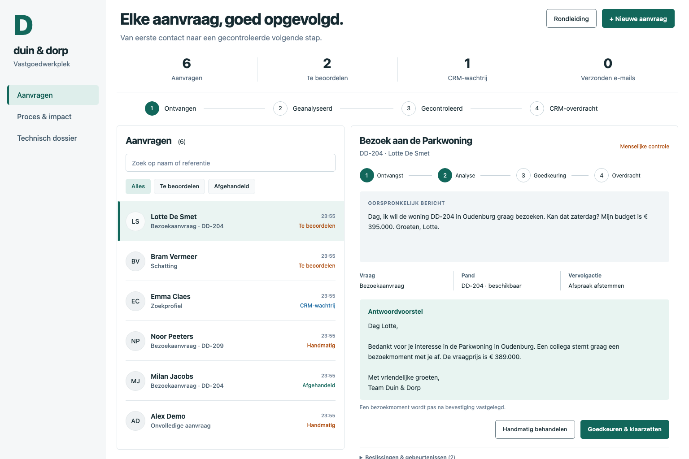
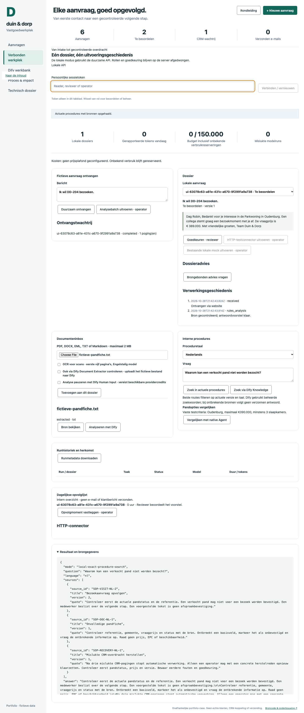
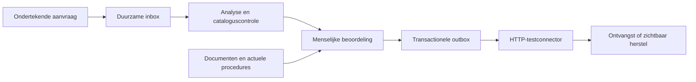

# Duin & Dorp · van aanvraag tot gecontroleerde overdracht

Een vastgoedaanvraag één keer ontvangen, het juiste pand controleren en het werk betrouwbaar aan een collega overdragen. Deze portfolio-case verbindt procesanalyse, een werkende dossierwerkplek en vijf Dify-flows met controleerbaar bewijs.

[](https://github.com/phlppgdfry/real-estate-automation-workbench/actions/workflows/verify-and-publish.yml)

**[Probeer de demo](https://phlppgdfry.github.io/real-estate-automation-workbench/?tour)** · **[Techniek & bewijs](https://phlppgdfry.github.io/real-estate-automation-workbench/?view=technical)** · **[Installatie](#zelf-draaien-zonder-modelbudget)** · **[English reviewer guide](docs/review-en.md)** · **[Bronpakket](https://github.com/phlppgdfry/real-estate-automation-workbench/releases/latest)**



> Onafhankelijke case voor een fictief vastgoedkantoor. Alle personen, aanvragen en panden zijn verzonnen. Gebouwd met AI-assistentie; geen relatie met een echte werkgever, productie-ervaring of gerealiseerde besparing geclaimd.

## Bekijk in twee minuten wat er toe doet

1. **Keur een voorstel goed.** De opdracht komt in de wachtrij; er is nog niets verstuurd.
2. **Laat de overdracht mislukken.** Bekijk retry, foutgeschiedenis en het herstelpad na drie fouten.
3. **Open een verkocht pand.** Bronregels blokkeren goedkeuring, ook als AI een bezoek herkent.
4. **Open Dify werkbank.** Bekijk een vastgelegde echte run met letterlijke broncitaten, zonder nieuwe modelrequest.
5. **Open Technisch dossier.** Vergelijk werkend gedrag, het runbewijs en de expliciete testgrenzen.

De publieke demo gebruikt browseropslag. De verbonden werkplek draait lokaal met echte HTTP-routes en SQLite. Dat onderscheid blijft zichtbaar; de openbare site ontvangt geen klantdossiers.

## Wat dit laat zien

| Onderdeel           | Concreet gedrag                                                                                             | Controleerbaar bewijs                                                                               |
| ------------------- | ----------------------------------------------------------------------------------------------------------- | --------------------------------------------------------------------------------------------------- |
| Duurzame intake     | Ontvangst vóór AI, duplicaatcontrole, workerleases en herstel na herstart                                   | [Storingsdrill](scripts/failure-drill.ts), [integratietests](tests/reliability.test.ts)             |
| Menselijk oordeel   | Aparte lees-, review- en operatorrechten; versiecontrole en actuele pandtoets                               | [API](server/app.ts), [domeinregels](src/domain.ts)                                                 |
| Documenten          | PDF/DOCX/EML/TXT/MD, begrensde OCR, exacte citaten, correcties en verlopen reviews                          | [Verbonden werkplek](docs/connected-workspace.md), [browsertests](tests/browser/connected.spec.ts)  |
| Dify in de praktijk | Vier gespecialiseerde apps, native Agent met Python-skill, Human Input en broncontrole                      | [Live runbewijs](public/dify/evidence.json), [importgids](docs/dify-integration.md)                 |
| Actuele procedures  | NL/FR- en versiefilters; onafhankelijke controle tegen beheerde bronnen                                     | [Knowledge API-bewijs](public/dify/knowledge-verification.json)                                     |
| Native planning     | Een echte Schedule Trigger voert drie modelvrije stappen uit                                                | [0,483 s / 0 tokens](public/dify/trigger-verification.json), [DSL](dify/apps/follow-up-trigger.yml) |
| Integratie          | Afzonderlijke HTTP-testdienst, idempotentiesleutel, rate limit en reconcile na onbekende uitkomst           | [Connector](server/crm-connector.ts), [herstarttest](tests/connected.test.ts)                       |
| Kritisch evalueren  | Gelijke criteria voor directe query, vaste workflow en native Agent; onderscheid lokale en Cloud-uitvoering | [Vergelijkingsmethode](docs/benchmark.md), [rapport](public/dify/benchmark.json)                    |



[Bekijk de echte lokale API-opname](public/dify/connected-local-demo.webm). De opname gebruikt fictieve data en maakt geen Dify-modelcalls.

## De belangrijkste ontwerpkeuze

AI levert een begrensd voorstel. Code controleert bronnen, prijs, status en bevoegdheid; een medewerker beslist. Goedkeuring en overdrachtsopdracht worden samen opgeslagen. Een provider- of CRM-storing verliest geen geaccepteerde aanvraag.



Lees [de architectuur](docs/architecture.md), [afwegingen](docs/decisions.md) en [het runbook](docs/operations.md). Er is geen e-mailtransport, autonoom schrijvende Agent of productiekoppeling met een vastgoed-CRM.

## Zelf draaien zonder modelbudget

Vereist: Node.js 24+, npm en Python 3. De browserdemo, lokale API, evaluatie en storingsdrill hebben geen accounts of betaalde API nodig.

```bash
git clone https://github.com/phlppgdfry/real-estate-automation-workbench.git
cd real-estate-automation-workbench
npm ci
npm run dev
# http://127.0.0.1:5187/real-estate-automation-workbench/?tour
```

Voor de verbonden dossierwerkplek:

```bash
npm run setup:local
npm run build
npm run server
# http://127.0.0.1:4318/real-estate-automation-workbench/?view=connected
# Tweede terminal: doorloopt ondertekende intake, review en CRM-mock
npm run demo:api
```

`setup:local` maakt afzonderlijke labtokens in de genegeerde `.env.local` met rechten 0600. Open dat bestand lokaal en gebruik de juiste rol in de werkplek. De token blijft in het tabbladgeheugen. [Documenttools, worker en HTTP-connector instellen](docs/connected-workspace.md) · [optionele configuratie](config/example.env).

```bash
npm run check          # evaluatie, build, tests, bron/DSL-sync, drill, API, links en repo-scan
npm run test:e2e       # echte browseracceptatie, ook tegen de lokale API
npm run benchmark     # geen model of netwerk; Cloud-paden expliciet niet uitgevoerd
npm run verify:install # volledige controle zonder Git en echte lokale HTTP-keten
```

Installeer voor browsertests eenmalig Chromium met `npx playwright install chromium`. De schone installatietest gebruikt de npm-cache; voer eerst `npm ci` uit. PDF vereist Poppler; OCR vereist Tesseract met `eng`. Controleer met `npm run install:check`.

## Dify importeren en bewijs beoordelen

De map [dify/apps](dify/apps/lead-intake.yml) bevat aanvraaganalyse, dossierassistent, documentcontrole, Agentvergelijking en een afzonderlijke opvolgtrigger. De native Agent heeft daarnaast [de gebundelde Python-skill](dify/agent/catalog-compare.skill.zip) nodig. De [vaste catalogusworkflow](dify/benchmarks/fixed-comparison.yml) is een afzonderlijke modelvrije benchmarkreferentie.

[Importvolgorde en herstel na import](docs/dify-integration.md) · [native Agent](docs/dify-agent-review.md) · [native trigger en lokale replay](docs/native-trigger.md) · [bewijs per claim](EVIDENCE.md).

Het huidige gratis Dify-modelquotum is opgebruikt. Bestaande live resultaten blijven inspecteerbaar; nieuwe modelruns zijn niet als geslaagd ingevuld. Native bestandsuitvoering, Human Input-hervatting en de nieuwe Cloud-benchmark vragen beschikbaar providerbudget. De native timer is wél op een echt gepland moment uitgevoerd en daarna uitgeschakeld. De menselijke labelreview en een volledig nieuwe Dify-workspace zijn nog niet onafhankelijk geverifieerd. [Volledige releasecontrole](docs/release-readiness.md).

## Kies je reviewroute

| Tijd           | Begin hier                                                                             |
| -------------- | -------------------------------------------------------------------------------------- |
| 2 minuten      | [Rondleiding](https://phlppgdfry.github.io/real-estate-automation-workbench/?tour)     |
| 5 minuten      | [Proces en businesscase](CASE_STUDY.md), [bewijsmatrix](EVIDENCE.md)                   |
| 15 minuten     | [Technische reviewroute](docs/reviewer-guide.md), `npm run drill`                      |
| Zelf overnemen | [Startgids](START-HERE.md), [beheer](docs/operations.md), [bijdragen](CONTRIBUTING.md) |

De calculator toont scenario-aannames; evaluatievoorbeelden zijn AI-geschreven regressies, geen onafhankelijke accuracymeting. Een exact citaat bewijst herkomst, geen juiste interpretatie. [Evaluatiemethode](docs/evaluation.md) · [menselijke review](docs/evaluation-human-review.md).

## Herkomst en licentie

Philippe Godfroy, met AI-assistentie, 2026. Code MIT; documentatie en fictieve data CC BY 4.0: [LICENSE](LICENSE). Afhankelijkheden behouden hun eigen licenties. Systeemfonts, geen externe fontverzoeken. De interface is HTML/CSS; screenshots en opnamen tonen de werkende toepassingen.

[Beveiligingsmelding](SECURITY.md) · [wijzigingen](CHANGELOG.md) · [statische samenvatting zonder JavaScript](public/fallback.html). Bedrijfsspecifiek onderzoek en sollicitatievoorbereiding staan buiten deze publieke repo.
