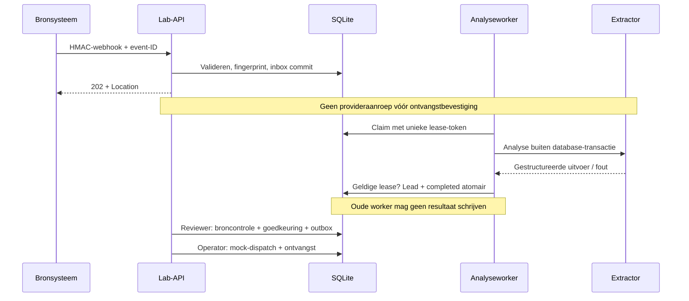

# Architectuur: ontvangst, analyse en uitvoering apart beheersen

Voor de technische reviewer. De [domeinregels](../src/domain.ts) zijn gedeeld; Pages simuleert lokaal en de API bewijst duurzame verwerking. Geen echte CRM- of e-mailactie.

## Twee adapters

|            | Pages                             | API                                                |
| ---------- | --------------------------------- | -------------------------------------------------- |
| Invoer     | Fictief formulier                 | Ondertekende webhook                               |
| Opslag     | Runtime-gevalideerde localStorage | SQLite WAL, migratieversie 3                       |
| Analyse    | Directe regelbaseline             | Duurzame inbox, begrensde worker                   |
| Identiteit | Expliciete demo-beoordelaar       | Afzonderlijke reader/reviewer/operator-credentials |
| CRM        | Pure lokale statusovergang        | Duurzame mock met unieke externe sleutel           |

De browser roept de API niet aan. `npm run demo:api` bewijst de HTTP-keten; `npm run drill` bewijst uitval, herstart en herstel zonder externe credentials. Labrollen zijn geen SSO of tenantisolatie.

## Ontvangst en verwerking

De webhook valideert maximaal 16 KiB exacte body, HMAC-SHA256 over `timestamp + '.' + body`, maximaal 300 seconden klokafwijking, en het intake-schema. `eventId` is uniek. Fingerprint wordt op canoniek gevalideerde velden berekend. Identieke herhaling geeft hetzelfde ontvangstbewijs; andere inhoud bij dezelfde ID geeft 409.

**202 betekent opgeslagen, niet geanalyseerd.** `Location` wijst naar een statusendpoint met leestoegang. Nieuw/pending geeft 202, completed geeft 200. De bron mag na bevestiging zijn leveringspoging afsluiten. Semantisch onbruikbare berichten blijven voor menselijke opvolging beschikbaar; syntactisch ongeldige berichten krijgen 400.

`POST /api/inbox/process` start een begrensde batch (standaard 10, maximaal 50). Dit is een handmatig getriggerde labworker, geen automatisch gedeployde wachtrijdienst. Elke claim heeft een unieke token en 30s lease. Een tweede worker kan pas claimen nadat die lease vervalt. Complete/fail controleren token én vervaltijd. Een oude worker wordt geweigerd, ook als de nieuwe worker al klaar is.

Geen database-transactie blijft open tijdens het wachten op een model. Leadcreatie en inbox-completion gebeuren samen. Analysefalen blijft bewaard met een generieke foutcode, backoff 2/4 seconden en na drie pogingen `dead`. Een crash tijdens de laatste lease wordt bij de volgende claim-scan terminaal gemaakt. Geen providerrespons, secret of berichttekst in operationele metrics.

Een geldige workerlease verhindert dubbele commits, maar belooft geen exactly-once modelaanroep. Na een crash kan analyse opnieuw plaatsvinden en opnieuw kosten veroorzaken. Er zijn geen modeltools of externe mutaties toegestaan in de extractor.

## Autorisatie en HTTP

[OpenAPI](openapi.json) beschrijft het contract. Reader/reviewer/operator mogen lezen. Alleen reviewer mag goedkeuren. Alleen operator mag de worker starten, dispatchen of mislukte verwerking opnieuw klaarzetten. Onbekende identiteit: 401; ontbrekende bevoegdheid: 403. Subject komt uit serverconfiguratie, nooit uit een requestbody. Drie tokens moeten verschillend zijn.

`GET /api/leads?limit=50&cursor=...` gebruikt begrensde keyset-paginering, maximaal 100. Duplicaatcontrole doet een directe sleutelquery, geen scan van alle persoonsgegevens. `GET /api/operations` geeft queue-aantallen en ouderdom zonder klantgegevens.

HMAC is geen encryptie. De API bindt localhost; productie vraagt TLS, SSO, rollen per organisatie, rate limits en uitgewerkt retentiebeleid. Ontbrekende CORS-headers zijn op zichzelf geen vervanging voor autorisatie.

## Goedkeuring, outbox en herstel

Goedkeuring vereist actuele `version` en ongewijzigde catalogus/voorstel. Goedkeuring en outbox ontstaan in één transactie. De mockworker verwerkt de lokale overdracht atomair met één uniek CRM-record en ontvangstbewijs. Die lokale garantie is geen exactly-once netwerkgarantie.

Een dead CRM-overdracht kan een operator met actuele versie en verplichte reden opnieuw klaarzetten. Oorspronkelijke goedkeurder en foutgeschiedenis blijven bewaard. Prijs, beschikbaarheid en ouderdom worden opnieuw getoetst. Bij gewijzigde bron blokkeert herstel: eerst herbeoordelen buiten dit labpad. Een apart operationeel auditrecord legt actor, reden en tijd vast; het is niet fraudebestendig.

Een echte netwerkconnector vraagt remote idempotentie, lease, timeout, jitter, rate-limitbeleid en afstemming bij een onbekende uitkomst. De huidige mock-dispatch houdt geen netwerktransactie open, omdat er geen netwerkactie is. Niet automatisch extrapoleren naar een echte CRM-adapter.

## Opslag en migratie

`server/schema.ts` past migraties atomair toe met `PRAGMA user_version`. De oorspronkelijke onversioneerde v1-tabellen worden behouden. Een nieuwere database dan de applicatie wordt geweigerd. Restart, tweeverbindingsclaims, rollback en migratie worden uitgevoerd in [de betrouwbaarheidstests](../tests/reliability.test.ts).

De leadbody en functionele audit blijven JSON. Inboxvelden zijn afzonderlijk geïndexeerd voor claimgedrag. SQLite en audit zijn niet door de app versleuteld of onveranderbaar gemaakt. Er is geen online back-updienst of tenantisolatie. [Runbook](operations.md), [senior review](senior-review.md).

## Dify-werkbank naast de duurzame intake

De bestaande inbox kan Dify gebruiken als extractor, zonder de ontvangsttransactie of outboxregels te wijzigen. Daarnaast heeft de server drie read-only reviewer-routes voor analysevoorbeelden, dossieradvies en documentcontrole. De dossierroute haalt de context zelf uit de lokale store; de browser kan geen vervalste feiten of bestaande conversatie-ID aanleveren. De documentroute minimaliseert contactpatronen vóór provider-I/O en valideert citaten opnieuw na de Dify-codeguard. Deze routes maken geen lead of CRM-opdracht.

De gebouwde React-app kan op dezelfde localhost-server worden bediend. De publieke GitHub Pages-versie gebruikt uitsluitend expliciet gelabeld opgeslagen runbewijs. Zie [Dify-installatie](dify-integration.md), [OpenAPI](openapi.json) en [lokale ketenverificatie](../public/dify/local-verification.json).
