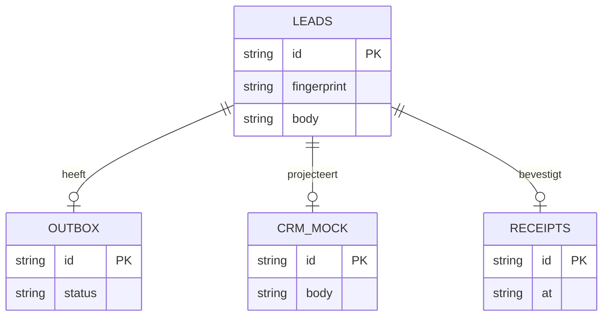

# Architectuur en grenzen

Voor de technische reviewer. Browser en server gebruiken dezelfde [domeinfuncties](../src/domain.ts), met aparte opslag- en transportadapters.

|             | Pages-demo             | Lokale API                              |
| ----------- | ---------------------- | --------------------------------------- |
| Invoer      | Fictief formulier      | HMAC-ondertekende webhook               |
| Extractie   | Herkenningsregels      | Regels of optionele OpenAI-adapter      |
| Opslag      | localStorage versie 1  | SQLite WAL, parametrische queries       |
| Goedkeuring | Demo-beoordelaar       | Bearer-token, actor door server bepaald |
| CRM         | Lokale statustransitie | Duurzame SQLite-mock met unieke sleutel |

De browser roept de API niet aan. Dat maakt de openbare demo zonder credentials beoordeelbaar. `npm run demo:api` toont de serverketen afzonderlijk. Productie vraagt een browseradapter met SSO/rollen; een client mag nooit zelf de identiteit van de beoordelaar bepalen.

## Lab-API

[OpenAPI 3.0.3](openapi.json) beschrijft de endpoints.

| Endpoint                       | Toegang          | Gedrag                                              |
| ------------------------------ | ---------------- | --------------------------------------------------- |
| `GET /health`                  | Open             | Modus, mockstatus, geen gevoelige gegevens          |
| `POST /api/webhooks/leads`     | HMAC + timestamp | Valideren, dedupliceren, analyseren, opslaan        |
| `GET /api/leads`               | Bearer           | Leads en tellers                                    |
| `POST /api/leads/{id}/approve` | Bearer           | Versie/bron controleren, goedkeuring + outbox       |
| `POST /api/outbox/dispatch`    | Bearer           | Eén batch mock-overdrachten, optioneel foutinjectie |

HMAC-SHA256 over `timestamp + '.' + exacte body`, hex. Headers: `x-timestamp` Unixseconden, `x-signature`. Maximaal 300 seconden klokafwijking. Constant-time vergelijking voor gelijke lengte. Maximum body 16 KiB; bericht max. 4.000 tekens; extra JSON-velden geweigerd. Geen CORS. De server bindt uitsluitend localhost. HMAC versleutelt geen data: productie vereist TLS.

### Idempotentie

`eventId` is uniek. SHA-256 over de gevalideerde input in vaste veldvolgorde is de fingerprint. Identieke herhaling geeft hetzelfde record; dezelfde ID met andere inhoud geeft 409. Een hash is geen anonimisering. Een andere event-ID van dezelfde persoon wordt bewust niet samengevoegd: dat kan een nieuwe vraag zijn. Contactmatching is een afzonderlijke CRM-beslissing.

### Transacties en outbox

Goedkeuring bevat `version`. Eén `BEGIN IMMEDIATE`-transactie leest de actuele lead, valideert status/versie/bron, en schrijft goedkeuring én outbox. Een geïnjecteerde insertfout bewijst rollback. Een herstart bewaart de outbox.

Worker: pending → succesvolle ontvangst, of backoff 2/4 seconden; na drie fouten `dead`. Demonstratietermijnen. `crm_mock.id` en `receipts.id` zijn uniek. De lokale transactie maakt record en ontvangst atomair. De JSON-audit is inspecteerbaar, maar wijzigbaar en niet fraudebestendig.

Dit is geen exactly-once netwerkgarantie. Een echte CRM-adapter heeft lease/worker-lock, timeout, remote idempotency-key, jitter, `Retry-After` en afstemming bij onbekende uitkomst nodig. Bij een timeout kan de andere kant al geschreven hebben. Niet blind opnieuw creëren. [Runbook](operations.md).

### AI

Responses API met strikt JSON-schema, `store:false`, maximaal 500 outputtokens en 15s timeout. Alleen berichttekst gaat naar het model, geen aparte naam/e-mailvelden. Vrije tekst kan alsnog persoonsgegevens bevatten; minimalisatie vóór productie is nodig. Geen tools, CRM of e-mailrechten.

Uitvoer: `intent`, `reference`, `evidence`. Zod en domeinregels controleren vorm, exact citaat en bronreferentie. Weigering/incomplete uitvoer/upstreamfout geeft 503; event wordt niet als geaccepteerd opgeslagen. De bron moet heraanbieden of handmatig overnemen. Voor productie zou eerst duurzaam ontvangen en daarna asynchroon analyseren deze afhankelijkheid beter isoleren.

`assess` toetst pandstatus, ouderdom (24 uur), referenties en bekende verdachte patronen. Patroondetectie is niet compleet; een citaat bewijst geen juiste interpretatie. De harde grens is geen tools, geen verzending en menselijke controle. De regels worden vóór goedkeuring opnieuw getoetst; een prijswijziging blokkeert ook een oud voorstel.

## Datamodel

JSON-leadbody houdt het lab klein. Productie vraagt normalisatie van audit/contact/taken, migraties, retentie en toegangsbeheer. SQLite wordt niet door deze app versleuteld.

Vorige: [proces](../CASE_STUDY.md). Volgende: [keuzes](decisions.md).
